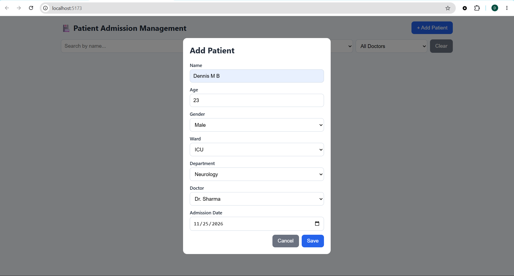
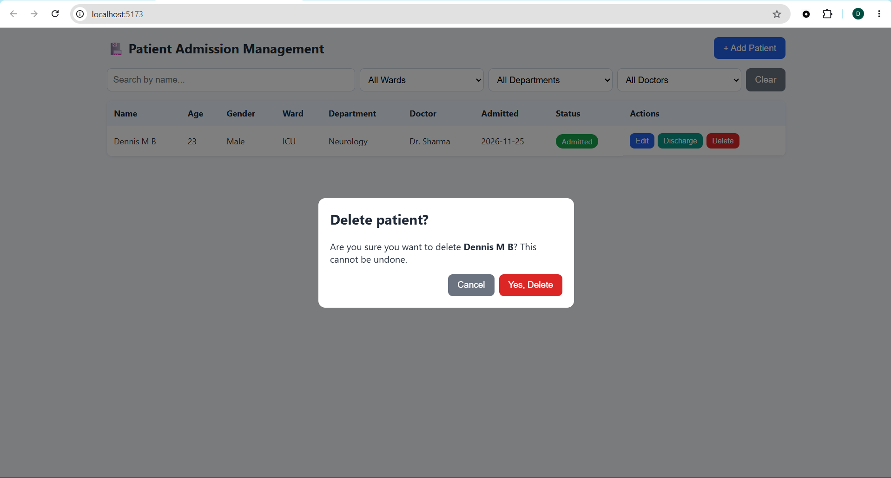

# Patient Admission Management App

Web app for hospital staff to manage admitted patients (DScribe Round 1 task).

## Live Links
- **Live app:** _add your Vercel/Netlify link here_
- **Backend API:** _add your PythonAnywhere link here_

## Tech Stack
- **Frontend:** React.js (Vite)
- **Backend:** Python (FastAPI)
- **Database:** SQLite (file-based, data persists after restart)

## Features
Add, view, edit, delete (with confirmation), search by name, filter by Ward / Department / Doctor, mark as Discharged, responsive on mobile / tablet / desktop. Validation in both frontend and backend.

## Run Locally

### Backend
```bash
cd backend
pip install -r requirements.txt
uvicorn main:app --reload --port 5000   # http://localhost:5000  (API docs: /docs)
```

### Frontend
```bash
cd frontend
npm install
npm run dev            # runs on http://localhost:5173
```
To point the frontend to a different backend, create `frontend/.env` with `VITE_API_URL=<backend url>` (see `.env.example`).

## API
| Method | Endpoint | Purpose |
|---|---|---|
| GET | /api/options | Dropdown values |
| GET | /api/patients?search=&ward=&department=&doctor= | List / search / filter |
| POST | /api/patients | Add patient |
| PUT | /api/patients/:id | Edit patient |
| DELETE | /api/patients/:id | Delete patient |
| PATCH | /api/patients/:id/discharge | Mark as discharged |

## Validation Rules
Name: required, letters only. Age: required, 0-120. Gender/Ward/Department/Doctor: required, from list. Admission Date: required, not in future. Backend returns HTTP 400 with a clear message per field.

## Screenshots




